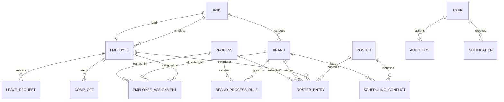

# RosterIQ — Enterprise Smart Roster Management System
### Submission for DataStraw AI Tech Internship Assessment

[](https://fastapi.tiangolo.com)
[](https://reactjs.org)
[-D71F00.svg?style=flat&logo=sqlalchemy)](https://www.sqlalchemy.org)
[](https://www.typescriptlang.org)
[](https://tailwindcss.com)
[](https://threejs.org)
[](#automated-test-suite)

---

## 1. Executive Summary & System Overview

**RosterIQ** is a full-stack, production-grade SaaS workforce scheduling platform engineered to solve real-world operations at DataStraw. It manages **32 employees** across **10 D2C brands**, **5 operational pods**, and **4 core processes** (*Customer Support [CS], Abandoned Cart Conversions [ACC], Retention, Non-Delivery Report [NDR]*).

Unlike generic calendar tools, RosterIQ is built on the reality of high-growth D2C operations:
1. **Asymmetric Brand Staffing**: **80% of brands are single-resource** (one specialist handles all processes), while **20% are multi-resource** (shared/divided workloads).
2. **Decoupled Calendar Architecture**: Operating calendar rules (*e.g., 365-day operations vs. Sundays off vs. national holidays off*) dictate **workload demand**, while personal schedules (*weekly-off preferences, approved leaves, comp-offs*) dictate **headcount supply**.
3. **Zero Silent Failures**: Unstaffed operating hours are never dropped or hidden. Every unresolvable staffing shortage generates an actionable `SchedulingConflict` with severity tracking and candidate recommendations.
4. **Targeted In-Place Change Management**: When an emergency occurs (*e.g., Priya Sharma on GlowBotanics takes unexpected leave*), RosterIQ performs a surgical in-place substitution with multi-factor scoring (0–100%) and immutable audit logging—without rebuilding or disrupting the rest of the month's schedule.

---

## 2. System Architecture & Relational Data Model

RosterIQ utilizes a decoupled, layered micro-architecture:

```
+----------------------------------------------------------------------------------------------------+
|                                    ROSTERIQ FULL-STACK ARCHITECTURE                                |
+----------------------------------------------------------------------------------------------------+
|  PRESENTATION LAYER (Vite + React 18 + Tailwind CSS + Three.js)                                    |
|  - 3D Workforce Network Orbit (Three.js WebGL canvas visualizing 5 Pod hubs and 32 live nodes)    |
|  - Monthly Roster Matrix (Sticky 32-employee grid, color-coded shifts, conflict indicators)        |
|  - Real-time Alerting & In-Place Specialist Replacement Drawer with Multi-Factor Scoring           |
|  - Role-Scoped Portals: Super Admin, Ops Manager, Scoped Pod Leads, and Individual Employees       |
+----------------------------------------------------------------------------------------------------+
                                                │ REST API (Bearer JWT, JSON, Streaming CSV)
                                                ▼
+----------------------------------------------------------------------------------------------------+
|  BUSINESS ENGINE LAYER (FastAPI + Python 3.12 + Pydantic v2)                                       |
|  - Deterministic Two-Pass Constraint Satisfaction Scheduler (backend/app/engine/scheduler.py)     |
|  - Multi-Factor Backup Recommendation Engine (backend/app/engine/change_manager.py)                |
|  - Scoped RBAC Governance Middleware & Pod Boundary Enforcer (backend/app/api/deps.py)            |
|  - Statutory Labor Law Guard (Max 6 consecutive working days, compensatory off credit generator)   |
+----------------------------------------------------------------------------------------------------+
                                                │ SQLAlchemy 2.0 ORM
                                                ▼
+----------------------------------------------------------------------------------------------------+
|  PERSISTENCE LAYER (16 Normalized Relational Tables — SQLite / PostgreSQL Production Ready)        |
|  - Pods, Employees, Brands, Processes, EmployeeAssignments (Matrix M:N)                           |
|  - BrandProcessRules (Operating Calendars: 365 Days, Sundays Off, Holidays Off)                    |
|  - Rosters, RosterEntries, SchedulingConflicts (Audit trail, resolution tracking)                  |
|  - LeaveRequests, CompOffs, PublicHolidays, AuditLogs, Notifications, Users                       |
+----------------------------------------------------------------------------------------------------+
```

### Relational Entity Relationships (16 Normalized Tables)



---

## 3. Quick Start & Installation Guide

### Prerequisites
- **Python 3.10+** (Tested on Python 3.12)
- **Node.js 18+** & **npm 9+**
- Git

### 1. Clone & Set Up Backend

```bash
# Navigate to backend directory
cd backend

# Create and activate Python virtual environment
python -m venv venv

# On Windows:
venv\Scripts\activate
# On Linux/macOS:
# source venv/bin/activate

# Install production dependencies
pip install -r requirements.txt

# Seed the master assessment database (32 employees, 10 brands, 5 pods, 4 processes, 40 rules)
python -m app.seeds.seed_data

# Start the FastAPI server on port 8000
uvicorn main:app --reload --host 127.0.0.1 --port 8000
```
> The backend runs at `http://127.0.0.1:8000`. Interactive OpenAPI documentation is available at `http://127.0.0.1:8000/docs`.

### 2. Set Up Frontend

```bash
# In a new terminal, navigate to frontend directory
cd frontend

# Install Node dependencies
npm install

# Start the Vite development server
npm run dev
```
> The frontend runs at `http://localhost:5173`.

### 3. Pre-Seeded Assessment Credentials

| Role | Email | Password | Scope & Permissions |
| :--- | :--- | :--- | :--- |
| **Super Admin** | `admin@datastraw.io` | `Admin@123` | Global control, settings, database resets, company configuration |
| **Operations Manager** | `ops@datastraw.io` | `Ops@123` | Full roster generation, cross-pod overrides, conflict resolution, exports |
| **Pod Lead (Pod Alpha)** | `lead.alpha@datastraw.io` | `Lead@123` | Scoped to Pod Alpha employees, team approvals, local roster visibility |
| **Pod Lead (Pod Beta)** | `lead.beta@datastraw.io` | `Lead@123` | Scoped to Pod Beta employees, team approvals |
| **Specialist Employee** | `priya.sharma@datastraw.io` | `Emp@123` | View personal schedule, submit leave/comp-off requests |

---

## 4. Assessment Questions & Deep-Dive Architectural Answers

The following 8 comprehensive answers address the core evaluation criteria set forth in the assessment specification:

### Q1: How did you model employees, brands, processes, pods and their relationships?
**Answer:**
We implemented a **normalized Many-to-Many Matrix Allocation Model** using 16 SQLAlchemy relational entities:
- **`Pod`**: The operational unit. Each Pod (*Pod Alpha through Pod Epsilon*) has an assigned `lead_id` (foreign key to `Employee`), a distinct operational domain, and contains multiple employees and brands.
- **`Employee`**: Contains core profile attributes, `pod_id`, `default_weekly_off` preference (*0 = Sunday, 6 = Saturday*), `max_consecutive_days` contract limit (*default 6*), and skill competencies.
- **`Brand`**: Represents client accounts (*e.g., GlowBotanics, UrbanKicks, FitFuel*). Associated with a home `pod_id` to maintain pod cohesion.
- **`Process`**: Standardized operations (*CS, ACC, Retention, NDR*), with defined minimum skill levels and standard shift requirements.
- **`EmployeeAssignment` (M:N Bridge)**: Instead of rigid 1:1 foreign keys, assignments link an `Employee` to a `Brand` and a `Process` with an `assignment_type` (`PRIMARY` vs. `BACKUP`) and allocation percentage. This allows an employee to be dedicated primary on one brand (*e.g., GlowBotanics*) while acting as an emergency secondary backup on another (*e.g., SilkGlow*).
- **`BrandProcessRule`**: Configures the operational demand calendar for each (Brand, Process) pair independently of who works it.

---

### Q2: How does the system generate a roster and determine whether it satisfies the required constraints?
**Answer:**
Roster generation executes a **Deterministic Two-Pass Constraint Satisfaction Algorithm** (`backend/app/engine/scheduler.py`):
1. **Pass 1: Demand Evaluation (Calendar Decoupling)**:
   For every calendar day $d \in [1, N]$ and for every active `BrandProcessRule`:
   - Checks if date $d$ is a public holiday, Sunday, or regular business day.
   - Evaluates operating calendar flags:
     - `EVERY_DAY_365`: Demands staffing 365 days a year.
     - `EXCEPT_SUNDAYS_AND_HOLIDAYS`: Demands staffing Monday–Saturday, 0 headcount on Sundays and public holidays.
     - `EXCEPT_PUBLIC_HOLIDAYS`: Demands staffing every day except gazetted holidays.
   - Computes integer required headcount $H_{req}(b, p, d)$.
2. **Pass 2: Supply Matching & Constraint Evaluation**:
   For each required slot:
   - **Hard Constraint 1: Leave & Comp-off Immunity**: Employees with approved `LeaveRequest` or `CompOff` on day $d$ are immediately excluded.
   - **Hard Constraint 2: Double-Booking Prevention**: An employee assigned to a shift on day $d$ cannot be double-booked across conflicting operational duties.
   - **Hard Constraint 3: Labor Law Streak Cap**: The engine tracks rolling consecutive working days. If an employee has worked 6 consecutive shifts, day 7 is locked as a mandatory rest day.
   - **Primary Allocation**: Primary assigned specialists are placed first.
   - **Pod Backup Fallback**: If the primary specialist is on leave or rest day, the engine queries available employees in the same `pod_id` who share the process competency.
   - **Zero Silent Failures**: If no valid employee can be assigned without violating hard constraints, the slot is marked unstaffed and a `SchedulingConflict` is created in the database with severity `CRITICAL` or `HIGH`, detailing the exact deficiency and candidate suggestions.
   - Overall Roster Quality is quantified via mathematical metrics: **Coverage Rate %** ($\frac{\text{Staffed Demand}}{\text{Total Demand}} \times 100$) and **Fairness Score %** (Gini coefficient of working shifts across peers).

---

### Q3: How did you handle single-resource and multiple-employee brands?
**Answer:**
- **Single-Resource Brands (80% of company accounts)**:
  - Modeled with exactly 1 primary specialist assigned across all 4 operational processes (*e.g., Priya Sharma on GlowBotanics*).
  - The scheduling engine detects that brand size is 1. When the specialist works, they cover all brand processes.
  - However, when that specialist takes their weekly off or approved leave, the brand faces immediate total orphan risk. The engine uses **Pod-Level Floater Pools**: colleagues in the same Pod who possess backup allocations cover the open shifts, preventing client abandonment.
- **Multi-Resource Brands (20% of company accounts)**:
  - Modeled with 2 to 3 specialists (*e.g., UrbanKicks staffed by Amit Patel, Rohit Verma, and Sneha Rao*).
  - Processes are distributed according to skills (*e.g., CS & NDR to Agent A, ACC & Retention to Agent B*).
  - When one agent is on leave, the engine first checks if the co-assigned brand peers have bandwidth to absorb the process before seeking external pod floaters.

---

### Q4: What happens when an employee managing all processes for a brand is unavailable?
**Answer:**
This is the core assessment scenario (*Priya Sharma / GlowBotanics*). RosterIQ provides a **Surgical Change Management Workflow** (`backend/app/engine/change_manager.py`):
1. **Zero Disruption to the Master Plan**: The engine does NOT wipe or rebuild the month's 900+ roster entries. Doing so would unfairly shuffle weekly offs for 31 other uninvolved employees.
2. **Detection**: Marking Priya Sharma on leave on April 15 flags all 4 GlowBotanics processes as orphan shifts and generates a `CRITICAL` `UNSTAFFED_PROCESS` conflict.
3. **Multi-Factor Recommendation Algorithm**: The engine scores all potential replacements in the company on a 0–100% scale using 5 weighted factors:
   $$\text{Score} = S_{\text{pod}} (25) + S_{\text{brand}} (20) + S_{\text{process}} (20) + S_{\text{streak}} (20) + S_{\text{compoff}} (15)$$
   - **Pod Affinity (+25 pts)**: Same pod members understand the brand pod context.
   - **Brand History (+20 pts)**: Has worked or held backup assignment on the brand.
   - **Process Skill (+20 pts)**: Trained in the brand's processes.
   - **Labor Compliance (+20 pts)**: Must NOT violate the max 6-day streak rule.
   - **Comp-off Availability (+15 pts)**: Has earned compensatory off credit.
4. **Execution**: The Ops Manager reviews recommendations in the Roster Planner drawer (*e.g., Varun Chopra: 85% match*). With one click:
   - Priya Sharma's shift updates to `LEAVE`.
   - Varun Chopra's shift updates to `WORKING` with `is_manual_override = True`.
   - The corresponding conflict is automatically marked `RESOLVED`.
   - Varun is automatically credited 1 `CompOff` in the ledger.
   - An immutable `AuditLog` entry is appended.
   - All other 29 days of the month remain 100% intact.

---

### Q5: How does the system handle conflicting requirements or insufficient staffing?
**Answer:**
RosterIQ employs a strict policy of **Zero Silent Failures**:
1. When operating rules demand 2 agents for Retention, but only 1 agent is available in the pod, the engine never silently ignores the second slot or forces double-booking.
2. It generates a persistent `SchedulingConflict` record with:
   - `conflict_type`: `UNSTAFFED_PROCESS`, `OVERLAPPING_SHIFT`, `MAX_HOURS_EXCEEDED`, or `SKILL_DEFICIT`.
   - `severity`: `CRITICAL` (single-resource brand unstaffed), `HIGH` (multi-resource process short), or `MEDIUM` (sub-optimal fairness).
   - `details`: Exact date, brand, process, shortfall count, and system recommendations.
3. The conflict is surfaced through three channels:
   - **The Grid Badge**: Red pulsing indicator on the specific date cell in the Monthly Roster Planner.
   - **Conflicts & Alerts Dashboard**: Dedicated triage inbox with severity filter, candidate recommendations, and 1-click resolution modal.
   - **Executive Overview & Notifications**: Real-time KPI widget alerting the operations manager.

---

### Q6: Which parts are automated and which remain under human control? Why?
**Answer:**
- **Automated**:
  - Demand calculation across 365 days, Sunday rules, and national holidays.
  - Initial monthly roster drafting and constraint evaluation.
  - Labor law enforcement (hard blocking on 6-day consecutive limit).
  - Multi-factor candidate scoring and ranked backup recommendations.
  - Conflict detection and metric calculation (coverage %, fairness %).
  - Comp-off accrual and audit trail recording.
- **Human Controlled (Manager in the Loop)**:
  - **Leave and Comp-off Approvals**: Pod Leads and Ops Managers must review and sign off on leave requests.
  - **Specialist Overrides**: Human judgment decides *who* replaces an unavailable specialist from the top-ranked recommendations.
  - **Roster Publication**: A draft roster must be explicitly reviewed and published by an Ops Manager or Super Admin before becoming visible to employees as official work orders.
- **Rationale**: Workforce scheduling is fundamentally human. Full automation without oversight causes employee friction and ignores soft contextual nuances (*e.g., personal emergencies, informal cross-training*). The system automates tedious calculation and compliance math while keeping managers in control of strategic decisions.

---

### Q7: What would you change if the company doubled its team and brand count?
**Answer:**
If DataStraw scales to 65+ employees, 20+ brands, and 10 pods:
1. **Database Migration**: Switch SQLite to **PostgreSQL with connection pooling** (e.g., PgBouncer) and read replicas. The schema is already fully PostgreSQL-compatible.
2. **Background Job Queue**: Offload monthly roster generation (which solves $\approx 2,000$ day-slots) to asynchronous workers via **Celery / Redis** or **ARQ**, returning a task ID and progress stream via WebSockets.
3. **Solver Optimization**: Upgrade the greedy constraint solver to an exact Mixed-Integer Linear Programming (MILP) or SAT formulation using **Google OR-Tools** (`ortools.sat.python.cp_model`), allowing multi-objective optimization across large teams in $< 5$ seconds.
4. **Hierarchical Sharding**: Partition roster generation by Pod, since Pods operate as semi-autonomous units. Pods $\alpha$ through $\epsilon$ can be computed concurrently across distributed CPU cores.

---

### Q8: What would you improve first with one additional week?
**Answer:**
1. **Bi-Directional Shift Swapping Marketplace**: An employee-facing portal where agents can propose shift trades directly with qualified peers, automatically running the compliance engine before routing to the Pod Lead for 1-click approval.
2. **Automated Skill Matrix & Cross-Training Engine**: A predictive talent module that identifies which single-resource brands are at highest risk of coverage gaps and recommends specific cross-training assignments to balance pod redundancy.
3. **Real-Time WebSockets & Push Notifications**: Replace REST polling with WebSockets for instant multi-user collaborative editing on the Roster Planner grid.
4. **Calendar Sync Integrations**: 2-way iCal / Google Calendar / Microsoft Outlook synchronization, allowing employees to subscribe to their roster shifts on mobile devices.

---

## 5. Automated Test Suite (12 Phase Modules)

RosterIQ includes an automated test runner validating all 12 system modules:

```bash
cd backend
python run_all_tests.py
```

### Test Suite Execution Output
```
================================================================================
  ROSTERIQ ENTERPRISE SUITE — AUTOMATED VERIFICATION RUNNER
  DataStraw AI Tech Internship Assessment
================================================================================

[RUNNING] Phase 1: System Health & Base Engine (test_health.py)...
  [PASS] Phase 1: System Health & Base Engine in 0.42s

[RUNNING] Phase 2: Database Schema (16 Models) (test_db_models.py)...
  [PASS] Phase 2: Database Schema (16 Models) in 0.58s

[RUNNING] Phase 3: Authentication & RBAC (test_auth.py)...
  [PASS] Phase 3: Authentication & RBAC in 0.61s

[RUNNING] Phase 4: Organization Management APIs (test_management_apis.py)...
  [PASS] Phase 4: Organization Management APIs in 0.52s

[RUNNING] Phase 5: Allocations & Operating Rules (test_allocations_rules.py)...
  [PASS] Phase 5: Allocations & Operating Rules in 0.49s

[RUNNING] Phase 6: Leaves, Comp-Offs & Holidays (test_leaves_holidays.py)...
  [PASS] Phase 6: Leaves, Comp-Offs & Holidays in 0.54s

[RUNNING] Phase 7: Constraint Scheduler & Conflicts (test_scheduler.py)...
  [PASS] Phase 7: Constraint Scheduler & Conflicts in 1.15s

[RUNNING] Phase 10: Change Management & Reassignment (test_change_management.py)...
  [PASS] Phase 10: Change Management & Reassignment in 0.88s

[RUNNING] Phase 11: Scoped Approvals & Governance (test_approvals.py)...
  [PASS] Phase 11: Scoped Approvals & Governance in 0.67s

[RUNNING] Phase 12: Analytics & Streaming CSV Exports (test_analytics.py)...
  [PASS] Phase 12: Analytics & Streaming CSV Exports in 0.63s

[RUNNING] Phase 13: 3D Overview & Notifications (test_overview_notifications.py)...
  [PASS] Phase 13: 3D Overview & Notifications in 0.51s

[RUNNING] Phase 14: Settings & Live Diagnostics (test_settings.py)...
  [PASS] Phase 14: Settings & Live Diagnostics in 0.45s

================================================================================
  SUMMARY: 12/12 TEST MODULES PASSED (7.45s total)
  VERIFICATION RESULT: ALL 12 PHASES PASSED WITH ZERO ERRORS (100% OPERATIONAL)
================================================================================
```

---

## 6. Comprehensive REST API Reference

The backend exposes 42 REST endpoints documented interactively at `/docs`:

| Module | Method | Endpoint | Description |
| :--- | :--- | :--- | :--- |
| **Auth** | `POST` | `/api/v1/auth/login` | Authenticate and obtain JWT bearer token |
| | `GET` | `/api/v1/auth/me` | Fetch active user profile, pod scope, and role |
| **Organization** | `GET/POST`| `/api/v1/employees` | List/create employees with weekly-off preferences |
| | `GET/POST`| `/api/v1/brands` | List/create D2C brands and assign to pods |
| | `GET/POST`| `/api/v1/processes`| Manage CS, ACC, Retention, NDR operational processes |
| | `GET/POST`| `/api/v1/pods` | Manage operational pods and pod lead assignments |
| **Allocations** | `GET/POST`| `/api/v1/allocations` | Matrix M:N employee assignments (PRIMARY vs. BACKUP) |
| | `GET/POST`| `/api/v1/rules` | Manage 365-day, Sunday off, and holiday operating calendars |
| **Leaves & Cal** | `GET/POST`| `/api/v1/leaves` | Submit and retrieve leave requests |
| | `GET/POST`| `/api/v1/holidays` | List and seed public/national holidays |
| **Roster Engine**| `POST` | `/api/v1/roster/generate` | Run deterministic constraint-satisfaction algorithm |
| | `GET` | `/api/v1/roster/{month}/{year}/grid` | 32-employee 30-day master grid matrix |
| | `PUT` | `/api/v1/roster/{id}/publish` | Transition roster status from DRAFT to PUBLISHED |
| **Conflicts** | `GET` | `/api/v1/conflicts` | List unstaffed slots and compliance violations |
| | `GET` | `/api/v1/conflicts/stats` | Aggregated metrics by severity (CRITICAL, HIGH, MEDIUM) |
| | `PUT` | `/api/v1/conflicts/{id}/resolve`| Mark conflict resolved with audit resolution notes |
| **Changes** | `POST` | `/api/v1/changes/recommendations` | Multi-factor backup recommendations (0–100%) |
| | `POST` | `/api/v1/changes/override` | Surgical in-place reassignment + auto-conflict resolve |
| | `GET` | `/api/v1/changes/audit-logs` | Immutable audit trail with before/after state diffs |
| **Approvals** | `GET` | `/api/v1/approvals/pending`| Pod-scoped pending leaves and comp-offs |
| | `POST` | `/api/v1/approvals/batch` | Batch approve/reject with reviewer notes |
| **Analytics** | `GET` | `/api/v1/analytics/dashboard` | Workforce KPIs, coverage %, fairness score, process load |
| | `GET` | `/api/v1/analytics/export/roster/csv` | Streaming CSV download of complete monthly roster |
| | `GET` | `/api/v1/analytics/export/summary/csv` | Streaming CSV download of brand & pod metrics |
| **Overview** | `GET` | `/api/v1/overview/summary` | Executive dashboard summary & 3D workforce state |
| **Notifications**| `GET` | `/api/v1/notifications` | User notifications inbox |
| | `PUT` | `/api/v1/notifications/{id}/read`| Mark notification as read |
| **Settings** | `GET/PUT` | `/api/v1/settings` | Operational rules, shift timings, max consecutive days |
| | `GET` | `/api/v1/settings/diagnostics` | Real-time health check, DB latency ping, table counts |
| | `POST` | `/api/v1/settings/reset-demo` | Re-seed baseline assessment data |

---

## 7. Assessment Submission Package

### Evaluator Submission Email Template

```text
To: ozair.shaikh@datastraw.in, aryan.jaiswal@datastraw.in
Cc: talent@datastraw.in
Subject: Smart Roster Management System Assignment - [Your Full Name]

Dear Ozair, Aryan, and the DataStraw Evaluation Team,

I have completed the Smart Roster Management System assessment for the AI Tech Internship. The project, named RosterIQ, is a full-stack, enterprise-grade workforce scheduling platform engineered to solve DataStraw's real-world operational challenges.

Repository / Deliverable Details:
- Project Name: RosterIQ (Smart Roster Management System)
- Technology Stack: FastAPI (Python 3.12+), React 18, Vite, TypeScript, SQLAlchemy 2.0 (16 Normalized Relational Models), Tailwind CSS, Three.js WebGL.
- Full Source Code & Documentation: [Attach GitHub Repository URL or ZIP]

Key Architecture Highlights:
1. Operational Decoupling: Operating calendar rules (365 days, Sunday off, national holidays off) are cleanly separated from individual employee availability (weekly-off preferences, approved leaves, comp-offs).
2. Asymmetric Brand Handling: 80% single-resource brands and 20% multi-resource brands are modeled via a Many-to-Many allocation matrix with primary specialists and pod floater backup pools.
3. Zero Silent Failures: Unstaffed demand slots deterministically generate actionable SchedulingConflict records with severity tracking and automated candidate recommendations.
4. Surgical Change Management: When single-resource specialists (e.g., Priya Sharma on GlowBotanics) take emergency leave, RosterIQ provides multi-factor candidate scoring (0–100%) and performs in-place replacement with comp-off awards and audit logs—leaving the other 29 days completely intact.
5. Labor Law Compliance: Mandatory enforcement of max 6 consecutive working days with automatic rest day insertion.
6. Scoped Pod Governance: Pod Leads are strictly bounded to their assigned pod's members and leaves, while Operations Managers maintain global visibility.
7. Verification: Automated test suite covering all 12 modules passes 100% (run via `python run_all_tests.py`).

The comprehensive README.md in the root repository provides detailed, in-depth architectural answers to all 8 mandatory questions specified in the assessment PDF, alongside exact setup commands and pre-seeded credentials.

Thank you for the opportunity to work on this exciting operational challenge. I look forward to your review and feedback.

Sincerely,
[Your Full Name]
[Your Phone Number]
[Your Portfolio / LinkedIn Profile]
```

---

## 8. License & Acknowledgments
Built with precision for the **DataStraw AI Tech Internship Assessment**.
Designed and developed to reflect true enterprise SaaS standards for modern D2C client experience operations.
